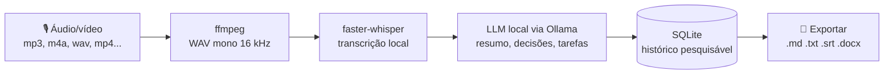

# Minutinha

> _Sua reunião virou ata num minutinho._

Aplicativo desktop **gratuito e open source** que transcreve reuniões e áudios e gera resumos com IA, **rodando 100% no seu computador**. Nada é enviado para servidores de terceiros.

> **Status:** 🚧 em planejamento: Fase 0 (Preparação). Ainda não há versão para download. Acompanhe pelo [roadmap](docs/roadmap.md).

## Por que existe

Ferramentas como Otter, Fireflies ou Notion AI são pagas ou limitadas no plano gratuito, e enviam o áudio para a nuvem. O Minutinha é:

- **Gratuito**: nenhuma etapa obrigatória depende de serviço pago.
- **Privado**: áudio, transcrição e resumo ficam no seu computador.
- **Offline**: depois de baixar os modelos, funciona sem internet.
- **Aberto**: qualquer pessoa pode usar, estudar e contribuir.

## Como funciona



1. Você arrasta um arquivo de áudio/vídeo (ou, a partir da v0.2, grava direto no app).
2. O **ffmpeg** converte para o formato que o Whisper espera.
3. O **faster-whisper** transcreve localmente, com barra de progresso e opção de cancelar.
4. Um **modelo de linguagem local** (Ollama) gera resumo, pontos principais, decisões, tarefas e pontos em aberto, usando só o que está na transcrição.
5. Tudo fica salvo em um **histórico** local, editável e exportável.

### Arquitetura

```
┌─────────────────────────────────────────────┐
│ INTERFACE (PySide6)                          │  nunca acessa Whisper ou banco direto
└──────────────────────┬──────────────────────┘
┌──────────────────────▼──────────────────────┐
│ SERVIÇOS (core): PipelineService             │  áudio → transcrição → resumo → salvar
└───────┬──────────────┬──────────────┬───────┘
   ┌────▼────┐   ┌─────▼──────┐  ┌────▼─────┐
   │ ÁUDIO   │   │ PROVEDORES │  │ STORAGE  │
   │ ffmpeg  │   │ Whisper    │  │ SQLite   │
   │ gravação│   │ Ollama ... │  │ arquivos │
   └─────────┘   └────────────┘  └──────────┘
```

Transcrição e resumo são **provedores trocáveis** (local, Groq, Gemini...) escolhidos pela configuração. Detalhes no [plano mestre §4](docs/plano-minutinha.md#4-arquitetura) e no [ADR 0006](docs/adr/0006-padrao-de-provedores.md).

### Stack

Python 3.11+ · PySide6 (Qt) · faster-whisper · Ollama · ffmpeg · SQLite + FTS5 · PyInstaller · uv · ruff · pytest · GitHub Actions. O porquê de cada escolha está nos [ADRs](docs/adr/README.md).

## Estrutura do plano

O projeto é guiado por um [**plano mestre**](docs/plano-minutinha.md), dividido em **7 fases**. Cada fase é um **milestone** no GitHub e cada tarefa é uma **issue** com título em Conventional Commits, critérios de aceite e o commit sugerido.

| Fase | Foco | Entrega |
|---|---|---|
| [0 — Preparação](docs/fases/fase-0-preparacao.md) | Ambiente, CI, prova de conceito com Whisper | Script que transcreve no terminal |
| [1 — Núcleo sem interface](docs/fases/fase-1-nucleo.md) | Áudio, provedores, banco, pipeline, CLI | Pipeline completo pelo terminal |
| [2 — Interface MVP](docs/fases/fase-2-interface-mvp.md) | Telas PySide6, threads, exportação | **v0.1** utilizável |
| [3 — Empacotamento](docs/fases/fase-3-empacotamento.md) | PyInstaller, ffmpeg embutido, onboarding, instaladores | Instaladores no GitHub Releases |
| [4 — Lançamento open source](docs/fases/fase-4-lancamento.md) | Licença, README final, CHANGELOG, divulgação | **v0.1 pública** |
| [5 — Gravação e busca](docs/fases/fase-5-gravacao-e-busca.md) | Microfone, áudio do sistema, FTS5, .srt/.docx | **v0.2** |
| [6 — Recursos avançados](docs/fases/fase-6-recursos-avancados.md) | Nuvem opcional, LLM embutido, diarização, chat | v0.3+ |

Lista completa de issues por fase: [docs/roadmap.md](docs/roadmap.md).

### Documentação

```
docs/
├── plano-minutinha.md   plano mestre (visão, arquitetura, dados, telas, riscos)
├── roadmap.md           fases → milestones → issues
├── fases/               uma página por fase, espelhando as issues
├── processo/            fluxo de branches, issues, PRs e Conventional Commits
└── adr/                 decisões de arquitetura
```

Índice completo: [docs/README.md](docs/README.md).

## Como contribuir

1. Escolha uma issue no [roadmap](docs/roadmap.md) (as marcadas com `good first issue` são boas para começar).
2. Crie a branch a partir de `develop`: `<tipo>/<nº-da-issue>-<descricao>`.
3. Faça commits seguindo [Conventional Commits](docs/processo/conventional-commits.md).
4. Abra o PR para `develop` com `Closes #<nº>` e atualize `docs/` se necessário.

| Branch | Papel |
|---|---|
| `main` | Produção: cada merge é uma versão publicada |
| `homologacao` | Validação da próxima versão (release candidate) |
| `develop` | Integração: base de todo trabalho novo |

Fluxo completo em [docs/processo/fluxo-de-trabalho.md](docs/processo/fluxo-de-trabalho.md).

## Requisitos de hardware (previstos)

| Perfil | Hardware | Modelo Whisper | LLM de resumo |
|---|---|---|---|
| Básico | CPU 4 núcleos, 8 GB RAM | `small` | ~3B parâmetros |
| Recomendado | CPU 8 núcleos, 16 GB RAM ou Apple M1+ | `large-v3-turbo` (int8) | ~7–8B |
| Ideal | GPU NVIDIA 6 GB+ VRAM | `large-v3-turbo` / `large-v3` | ~7–14B |

Medições reais serão publicadas na Fase 4.

## Privacidade

Todo o processamento é local. Nenhum áudio, transcrição ou resumo sai do seu computador, a menos que você ative explicitamente um provedor em nuvem (opcional, Fase 6). Ao gravar reuniões, obtenha o consentimento dos participantes (LGPD).

## Licença

MIT (a ser adicionada na [Fase 4](docs/fases/fase-4-lancamento.md); ver [ADR 0005](docs/adr/0005-licenca-mit.md)).
