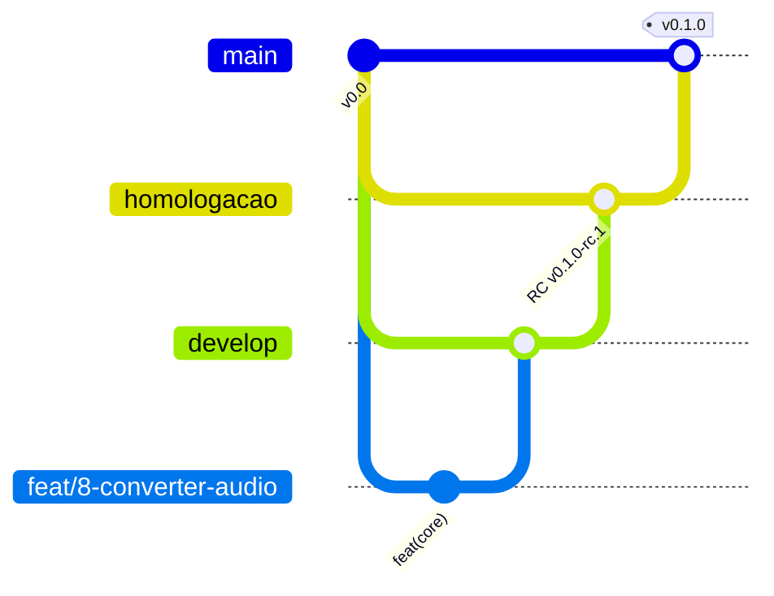

# Fluxo de trabalho

Como o trabalho sai de uma ideia e chega ao usuário no Minutinha: **issue → branch → commits → PR → develop → homologacao → main → release**.

## 1. Branches



| Branch | Papel | Recebe merge de | Quem pode fazer push direto |
|---|---|---|---|
| `main` | **Produção.** Cada merge corresponde a uma versão publicada (tag `vX.Y.Z` → GitHub Release). | `homologacao` (e `hotfix/*`) | ninguém — só via PR |
| `homologacao` | **Validação.** Candidata a release: testes manuais, teste do instalador em máquinas limpas, revisão do CHANGELOG. Tags `vX.Y.Z-rc.N`. | `develop` (e `hotfix/*`) | ninguém — só via PR |
| `develop` | **Integração.** Base de todo trabalho novo. Sempre deve passar no CI. | branches de trabalho | ninguém — só via PR |
| `<tipo>/<issue>-<descricao>` | Trabalho de **uma** issue. Vida curta. | — | autor |

### Branches de trabalho

Nome: `<tipo>/<número-da-issue>-<descricao-curta-em-kebab-case>`, sempre criadas a partir de `develop`.
O `<tipo>` é o mesmo do Conventional Commit do título da issue.

```
feat/8-converter-audio-para-wav-mono-16-khz
fix/42-crash-ao-cancelar-transcricao
docs/3-documentar-instalacao-do-ffmpeg
ci/2-rodar-lint-e-testes
```

Cada issue já traz a branch sugerida na seção **Como entregar**.

### Hotfix

Bug crítico em produção: crie `hotfix/<issue>-<descricao>` a partir de `main`, abra PR para `main` e, depois do merge, leve a correção para `homologacao` e `develop` (merge de `main` nas duas) para não perdê-la.

## 2. Ciclo de uma issue

1. **Escolha uma issue** no [roadmap](../roadmap.md) ou nos milestones e atribua a si mesmo.
2. **Crie a branch**:
   ```bash
   git switch develop && git pull
   git switch -c feat/8-converter-audio-para-wav-mono-16-khz
   ```
3. **Commits pequenos** seguindo [Conventional Commits](conventional-commits.md).
4. **Documente**: se a mudança altera comportamento, arquitetura ou decisões, atualize `docs/` no mesmo PR (decisão nova → novo [ADR](../adr/README.md)).
5. **Abra o PR para `develop`** usando o template, com `Closes #<número>` na descrição.
6. **CI verde + revisão** (mesmo sozinho: releia o diff no GitHub antes de aprovar).
7. **Merge com squash**: o título do PR vira o commit em `develop`, então ele **também** segue Conventional Commits.
8. **Feche a issue manualmente** depois do merge: o GitHub só fecha issues pelo `Closes #N` quando o PR entra na branch padrão (`main`), e nosso trabalho entra em `develop`. Marque também o item no [roadmap](../roadmap.md) no próprio PR.
9. Apague a branch.

## 3. Release

1. PR `develop → homologacao` com título `chore(release): v0.1.0-rc.1`.
2. Em `homologacao`: rodar o checklist de [teste do instalador](../desenvolvimento/teste-instalador.md) (criado na Fase 3), corrigir o que aparecer (branches a partir de `develop`, repetir o passo 1).
3. Atualizar `CHANGELOG.md` e a versão no `pyproject.toml`.
4. PR `homologacao → main` com título `chore(release): v0.1.0` — **merge commit** (sem squash) para preservar o histórico.
5. Tag `v0.1.0` em `main` → workflow de release publica os instaladores.

## 4. Issues

- **Título** em Conventional Commits: `tipo(escopo): descrição no imperativo` — o mesmo texto do commit/PR que vai fechá-la.
- **Corpo** padrão: Contexto · O que fazer · Critérios de aceite · Arquivos envolvidos · Como entregar · Commit sugerido · Referências.
- **Milestone** = fase do roadmap.
- **Labels**:

| Grupo | Labels |
|---|---|
| Tipo | `feat`, `fix`, `docs`, `chore`, `build`, `ci`, `test`, `refactor`, `perf`, `style` |
| Área | `área: core`, `área: providers`, `área: storage`, `área: ui`, `área: recorder`, `área: build`, `área: repo` |
| Comunidade | `good first issue`, `help wanted` |

Os templates ficam em [`.github/ISSUE_TEMPLATE/`](../../.github/ISSUE_TEMPLATE).

## 5. Proteções recomendadas no GitHub

Em *Settings → Branches*, para `main`, `homologacao` e `develop`:

- Exigir Pull Request antes do merge.
- Exigir que o CI (`ci.yml`) passe.
- Bloquear force push e exclusão.

> Repositórios privados em conta gratuita não aplicam regras de proteção; elas passam a valer quando o repositório for público (Fase 4). Até lá, siga o fluxo por disciplina.
