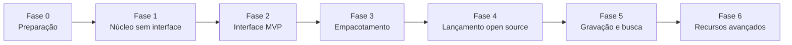

# Roadmap

Visão consolidada das fases do [plano mestre](plano-minutinha.md#10-roadmap-por-fases). Cada fase é um **milestone** no GitHub e cada item é uma **issue** com título em Conventional Commits.

| Fase | Duração | Versão | Entregável | Issues |
|---|---|---|---|---|
| [Fase 0 — Preparação](fases/fase-0-preparacao.md) | 1 semana | — | Ambiente pronto + script que transcreve um mp3 no terminal. | [#1](https://github.com/ArthurSouzaDev/minutinha/issues/1)–[#5](https://github.com/ArthurSouzaDev/minutinha/issues/5) (5) |
| [Fase 1 — Núcleo sem interface](fases/fase-1-nucleo.md) | 1–2 semanas | — | Pipeline completo funcionando pelo terminal e gravando no SQLite. | [#6](https://github.com/ArthurSouzaDev/minutinha/issues/6)–[#19](https://github.com/ArthurSouzaDev/minutinha/issues/19) (14) |
| [Fase 2 — Interface MVP](fases/fase-2-interface-mvp.md) | 2–3 semanas | v0.1 | v0.1 utilizável no dia a dia (rodando via `python -m minutinha`). | [#20](https://github.com/ArthurSouzaDev/minutinha/issues/20)–[#28](https://github.com/ArthurSouzaDev/minutinha/issues/28) (9) |
| [Fase 3 — Empacotamento](fases/fase-3-empacotamento.md) | 1–2 semanas | v0.1 (instalável) | Instalador baixável no GitHub Releases. | [#29](https://github.com/ArthurSouzaDev/minutinha/issues/29)–[#36](https://github.com/ArthurSouzaDev/minutinha/issues/36) (8) |
| [Fase 4 — Lançamento open source](fases/fase-4-lancamento.md) | 1 semana | v0.1 pública | v0.1 pública. | [#37](https://github.com/ArthurSouzaDev/minutinha/issues/37)–[#41](https://github.com/ArthurSouzaDev/minutinha/issues/41) (5) |
| [Fase 5 — Gravação e busca](fases/fase-5-gravacao-e-busca.md) | 2–4 semanas | v0.2 | v0.2. | [#42](https://github.com/ArthurSouzaDev/minutinha/issues/42)–[#51](https://github.com/ArthurSouzaDev/minutinha/issues/51) (10) |
| [Fase 6 — Recursos avançados](fases/fase-6-recursos-avancados.md) | contínuo | v0.3+ | Entregas incrementais a partir da v0.3. | [#52](https://github.com/ArthurSouzaDev/minutinha/issues/52)–[#59](https://github.com/ArthurSouzaDev/minutinha/issues/59) (8) |

## Todas as issues

### Fase 0 — Preparação

- [x] [#1](https://github.com/ArthurSouzaDev/minutinha/issues/1) `chore: configurar projeto Python 3.11+ com uv, ruff e pytest`
- [x] [#2](https://github.com/ArthurSouzaDev/minutinha/issues/2) `ci: rodar lint (ruff) e testes (pytest) a cada push e pull request`
- [x] [#3](https://github.com/ArthurSouzaDev/minutinha/issues/3) `docs: documentar instalação do ffmpeg e do Ollama para desenvolvimento`
- [x] [#4](https://github.com/ArthurSouzaDev/minutinha/issues/4) `docs: registrar estudos de PySide6, QThread e sqlite3`
- [ ] [#5](https://github.com/ArthurSouzaDev/minutinha/issues/5) `feat(poc): transcrever um mp3 no terminal com faster-whisper`

### Fase 1 — Núcleo sem interface

- [ ] [#6](https://github.com/ArthurSouzaDev/minutinha/issues/6) `feat(config): carregar configurações do usuário e pastas de dados com platformdirs`
- [ ] [#7](https://github.com/ArthurSouzaDev/minutinha/issues/7) `feat(core): adicionar logging em arquivo na pasta de dados`
- [ ] [#8](https://github.com/ArthurSouzaDev/minutinha/issues/8) `feat(core): converter áudio para WAV mono 16 kHz e obter duração com ffmpeg`
- [ ] [#9](https://github.com/ArthurSouzaDev/minutinha/issues/9) `feat(providers): definir interfaces de provedores e a dataclass Segmento`
- [ ] [#10](https://github.com/ArthurSouzaDev/minutinha/issues/10) `feat(providers): transcrever localmente com faster-whisper e reportar progresso`
- [ ] [#11](https://github.com/ArthurSouzaDev/minutinha/issues/11) `feat(providers): gerar resumo via API HTTP local do Ollama`
- [ ] [#12](https://github.com/ArthurSouzaDev/minutinha/issues/12) `feat(providers): criar factory que escolhe provedores pela configuração`
- [ ] [#13](https://github.com/ArthurSouzaDev/minutinha/issues/13) `feat(prompts): adicionar prompt padrão de resumo de reunião`
- [ ] [#14](https://github.com/ArthurSouzaDev/minutinha/issues/14) `feat(core): resumir transcrições longas com estratégia map-reduce`
- [ ] [#15](https://github.com/ArthurSouzaDev/minutinha/issues/15) `feat(storage): criar banco SQLite com migrações versionadas`
- [ ] [#16](https://github.com/ArthurSouzaDev/minutinha/issues/16) `feat(storage): implementar repositório de reuniões e segmentos`
- [ ] [#17](https://github.com/ArthurSouzaDev/minutinha/issues/17) `feat(core): orquestrar pipeline áudio → transcrição → resumo → salvar`
- [ ] [#18](https://github.com/ArthurSouzaDev/minutinha/issues/18) `feat(cli): adicionar comandos transcrever e listar no terminal`
- [ ] [#19](https://github.com/ArthurSouzaDev/minutinha/issues/19) `test(core): adicionar fixture de áudio curto e testes do pipeline`

### Fase 2 — Interface MVP

- [ ] [#20](https://github.com/ArthurSouzaDev/minutinha/issues/20) `docs(ui): desenhar wireframes das telas do MVP`
- [ ] [#21](https://github.com/ArthurSouzaDev/minutinha/issues/21) `feat(ui): criar janela principal com histórico agrupado por data`
- [ ] [#22](https://github.com/ArthurSouzaDev/minutinha/issues/22) `feat(ui): criar tela de nova transcrição com arrastar e soltar`
- [ ] [#23](https://github.com/ArthurSouzaDev/minutinha/issues/23) `feat(ui): processar em QThread com progresso, tempo estimado e cancelar`
- [ ] [#24](https://github.com/ArthurSouzaDev/minutinha/issues/24) `feat(ui): criar tela de detalhe com abas Resumo e Transcrição editáveis`
- [ ] [#25](https://github.com/ArthurSouzaDev/minutinha/issues/25) `feat(core): exportar reunião para Markdown e texto`
- [ ] [#26](https://github.com/ArthurSouzaDev/minutinha/issues/26) `feat(ui): criar tela de configurações`
- [ ] [#27](https://github.com/ArthurSouzaDev/minutinha/issues/27) `feat(ui): exibir erros com mensagens amigáveis`
- [ ] [#28](https://github.com/ArthurSouzaDev/minutinha/issues/28) `style(ui): aplicar tema visual base e ícone do app`

### Fase 3 — Empacotamento

- [ ] [#29](https://github.com/ArthurSouzaDev/minutinha/issues/29) `build: gerar executável com PyInstaller em modo onedir`
- [ ] [#30](https://github.com/ArthurSouzaDev/minutinha/issues/30) `build: embutir o ffmpeg no pacote`
- [ ] [#31](https://github.com/ArthurSouzaDev/minutinha/issues/31) `feat(core): baixar modelos Whisper sob demanda com progresso`
- [ ] [#32](https://github.com/ArthurSouzaDev/minutinha/issues/32) `feat(ui): criar onboarding de primeiro uso`
- [ ] [#33](https://github.com/ArthurSouzaDev/minutinha/issues/33) `build: criar instaladores para Windows, macOS e Linux`
- [ ] [#34](https://github.com/ArthurSouzaDev/minutinha/issues/34) `ci: publicar builds no GitHub Releases ao criar tag v*`
- [ ] [#35](https://github.com/ArthurSouzaDev/minutinha/issues/35) `feat(core): avisar quando houver nova versão disponível`
- [ ] [#36](https://github.com/ArthurSouzaDev/minutinha/issues/36) `test(build): validar instaladores em máquinas limpas`

### Fase 4 — Lançamento open source

- [ ] [#37](https://github.com/ArthurSouzaDev/minutinha/issues/37) `chore: adicionar LICENSE MIT, CONTRIBUTING.md e CODE_OF_CONDUCT.md`
- [ ] [#38](https://github.com/ArthurSouzaDev/minutinha/issues/38) `docs: completar README com GIF de demonstração, instalação e requisitos`
- [ ] [#39](https://github.com/ArthurSouzaDev/minutinha/issues/39) `docs: criar CHANGELOG.md seguindo SemVer`
- [ ] [#40](https://github.com/ArthurSouzaDev/minutinha/issues/40) `docs: publicar tabela real de desempenho por hardware`
- [ ] [#41](https://github.com/ArthurSouzaDev/minutinha/issues/41) `chore: selecionar issues good first issue e divulgar o lançamento`

### Fase 5 — Gravação e busca

- [ ] [#42](https://github.com/ArthurSouzaDev/minutinha/issues/42) `feat(recorder): gravar microfone salvando em arquivo durante a gravação`
- [ ] [#43](https://github.com/ArthurSouzaDev/minutinha/issues/43) `feat(recorder): gravar áudio do sistema em Windows, macOS e Linux`
- [ ] [#44](https://github.com/ArthurSouzaDev/minutinha/issues/44) `feat(recorder): mixar microfone e áudio do sistema em um único arquivo`
- [ ] [#45](https://github.com/ArthurSouzaDev/minutinha/issues/45) `feat(ui): exibir aviso de consentimento ao iniciar uma gravação`
- [ ] [#46](https://github.com/ArthurSouzaDev/minutinha/issues/46) `feat(storage): buscar texto em todas as reuniões com FTS5`
- [ ] [#47](https://github.com/ArthurSouzaDev/minutinha/issues/47) `feat(storage): extrair e listar tarefas do resumo`
- [ ] [#48](https://github.com/ArthurSouzaDev/minutinha/issues/48) `feat(core): exportar legendas .srt e .vtt`
- [ ] [#49](https://github.com/ArthurSouzaDev/minutinha/issues/49) `feat(core): exportar reunião para .docx`
- [ ] [#50](https://github.com/ArthurSouzaDev/minutinha/issues/50) `feat(prompts): permitir prompts de resumo personalizáveis`
- [ ] [#51](https://github.com/ArthurSouzaDev/minutinha/issues/51) `feat(ui): tornar marcações de tempo clicáveis com reprodução do áudio`

### Fase 6 — Recursos avançados

- [ ] [#52](https://github.com/ArthurSouzaDev/minutinha/issues/52) `feat(providers): adicionar provedores em nuvem opcionais (Groq e Gemini)`
- [ ] [#53](https://github.com/ArthurSouzaDev/minutinha/issues/53) `feat(providers): embutir modelo de resumo com llama-cpp-python`
- [ ] [#54](https://github.com/ArthurSouzaDev/minutinha/issues/54) `feat(providers): separar falantes com diarização (pyannote)`
- [ ] [#55](https://github.com/ArthurSouzaDev/minutinha/issues/55) `feat(ui): adicionar ícone na bandeja e atalho global para gravar`
- [ ] [#56](https://github.com/ArthurSouzaDev/minutinha/issues/56) `feat(core): conversar com o histórico de reuniões`
- [ ] [#57](https://github.com/ArthurSouzaDev/minutinha/issues/57) `feat(core): exportar tarefas para Notion, Trello e Google Calendar`
- [ ] [#58](https://github.com/ArthurSouzaDev/minutinha/issues/58) `feat(core): traduzir a transcrição`
- [ ] [#59](https://github.com/ArthurSouzaDev/minutinha/issues/59) `feat(ui): internacionalizar a interface`

> Marque o checkbox aqui quando a issue for fechada, ou confira o andamento direto nos [milestones](https://github.com/ArthurSouzaDev/minutinha/milestones).
